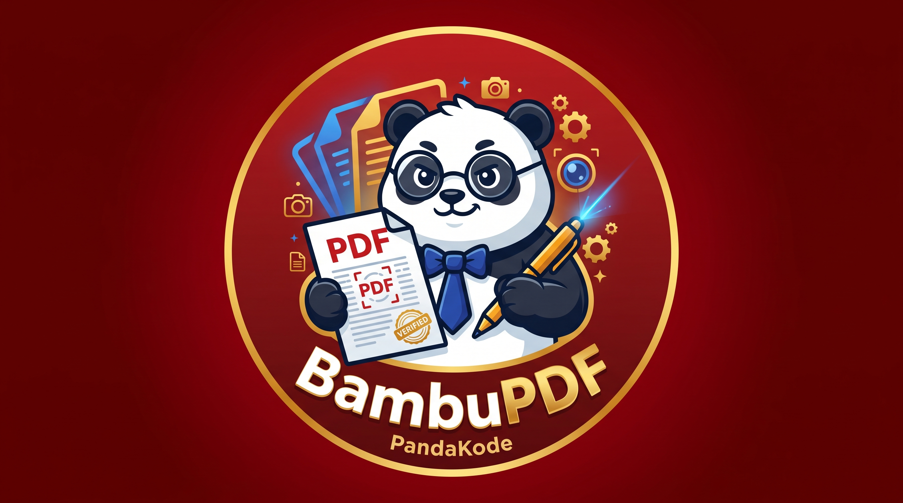

# 🐼 BambuPDF Super Suite — AI CamScanner, OCR & Crypto-Seal Studio
### **Official Native Android Document Ecosystem by PandaKode**

-DC2626?style=for-the-badge&logo=jetpackcompose&logoColor=white)

**BambuPDF Super Suite** adalah aplikasi studio dokumen dan pemindai cerdas (*All-in-One PDF & CamScanner*) berbasis **Native Android (Kotlin & Jetpack Compose)** dengan identitas visual *Imperial Crimson, Sapphire Blue & Royal Gold*. Dirancang untuk memproses pemindaian dokumen, ekstraksi teks AI OCR, pencetakan lembar KTP & Pasfoto A4, penggabungan PDF, hingga tanda tangan digital bersegel kriptografi **100% secara lokal (Offline-First) di perangkat pengguna**.

---

## 📸 Tampilan Aplikasi (Screenshots)

| Splash Screen | AI CamScanner & Magic Filter | Studio TTD & Stempel Kantor | KTP 2-in-1 & Pasfoto A4 | AI OCR & PDF Merger |
| :---: | :---: | :---: | :---: | :---: |
| *(Tarik & Lepas SS 1)* | *(Tarik & Lepas SS 2)* | *(Tarik & Lepas SS 3)* | *(Tarik & Lepas SS 4)* | *(Tarik & Lepas SS 5)* |

---

## ✨ 7 Fitur Unggulan (Killer Features)

### 1. 📷 Smart AI CamScanner (Auto Edge-Detection & Magic Filter)
* **Deteksi Tepi Kertas Otomatis:** Bertenaga *Google ML Kit Document Scanner* yang memotong latar belakang meja (*auto-crop*) dan meluruskan dokumen miring (*deskew*) secara otomatis.
* **5 Mode Filter Dokumen:** *Magic Pro Color* (menajamkan teks & memutihkan kertas), *Hitam-Putih Tegas (Hemat Tinta)*, *Abu-Abu Resmi*, *Kertas Buku Klasik*, dan *Warna Asli*.
* **Meja Kerja Halaman Interaktif:** Mendukung rotasi halaman $90^\circ$, pengurutan posisi halaman maju/mundur, penomoran halaman otomatis (`Halaman X dari Y`), serta pilihan ukuran kertas (**A4, F4/Folio, US Letter**).

### 2. 🔏 QR Crypto-Seal E-Signature & Stempel Kantor Digital
* **Kanvas Tanda Tangan Jari:** Goreskan tanda tangan langsung di layar ponsel dengan pilihan warna tinta (*Biru Resmi, Hitam Tegas, Merah Marun*).
* **Stempel QR Validasi Otomatis (SHA-256):** Menyematkan kode QR keaslian di kaki dokumen PDF yang memuat nama penandatangan, jabatan, waktu terbit, dan *hash* unik dokumen.
* **Stempel Basah Kantor:** Pilihan cap digital miring otomatis (`LUNAS / PAID`, `DISETUJUI / APPROVED`, `DOKUMEN ASLI`, `RAHASIA`, dan `TERVERIFIKASI LAB`).

### 3. 🔍 Smart AI OCR (Image-to-Text & Text-to-PDF)
* Mengekstrak tulisan dari foto kertas, buku, surat, atau catatan secara instan menggunakan *On-Device Machine Learning* (tanpa internet).
* Teks hasil ekstraksi dapat langsung diedit, disalin ke *Clipboard*, atau dikonversi menjadi dokumen PDF resmi baru.

### 4. 🧩 PDF Merger (Gabungkan Banyak File PDF)
* Menggabungkan 2 atau lebih dokumen PDF yang terpisah di penyimpanan ponsel menjadi **1 file PDF utuh** secara cepat dan rapi.

### 5. 🪪 Smart ID Card 2-in-1 Sheet (Pelindung KTP Anti-Penyalahgunaan)
* Menyusun foto **Tampak Depan & Belakang KTP/Kartu** secara proporsional di tengah 1 lembar PDF ukuran A4.
* Dilengkapi **Segel Watermark Melintang** (*"HANYA UNTUK VERIFIKASI - TANGGAL & JAM"*) untuk mencegah penyalahgunaan identitas digital.

### 6. 📸 Studio Cetak Pasfoto A4 (Ukuran 2x3, 3x4 & 4x6 Sekaligus)
* Hanya dengan memilih 1 foto wajah, aplikasi otomatis menyusun paket siap cetak di kertas A4 yang berisi ukuran **4x6 cm (4 lembar)**, **3x4 cm (5 lembar)**, dan **2x3 cm (6 lembar)** lengkap dengan bingkai latar **Merah Formal / Biru Resmi** dan garis potong.

### 7. 📄 Generator Surat Resmi, Invoice & Pembaca PDF Bawaan
* Membuat surat pengantar atau kwitansi pembayaran lengkap dengan Kop Surat, Kotak Nominal, Stempel Kantor, dan Tanda Tangan dalam hitungan detik.
* Dilengkapi **Built-in PDF Viewer** berbasis `Android PdfRenderer` untuk memeriksa ketajaman setiap halaman PDF sebelum dibagikan ke WhatsApp atau Email.

---

## 🛠️ Tech Stack & Arsitektur

| Komponen | Teknologi yang Digunakan |
| :--- | :--- |
| **Bahasa & UI** | 100% Kotlin + Jetpack Compose (Material Design 3) |
| **PDF Engine** | Native Android `PdfDocument`, `PdfRenderer`, & 2D `Canvas` API |
| **AI Document Scanner** | `com.google.android.gms:play-services-mlkit-document-scanner` |
| **AI Text Recognition (OCR)** | `com.google.mlkit:text-recognition` (On-Device Latin OCR) |
| **Crypto-Seal QR Engine** | ZXing Core (`com.google.zxing:core`) + `java.security.MessageDigest` (SHA-256) |
| **Image Enhancement** | Custom `ColorMatrix` & `ColorMatrixColorFilter` Pipeline |

---

## 👨‍💻 Pengembang (Author)

Dikembangkan oleh **Muhammad Saputra**  
🏢 **Founder of PandaKode** *(Software House — Android Apps, Web Systems, IoT Solutions, Desktop Apps & Games)*  
📍 Pekanbaru, Riau, Indonesia
